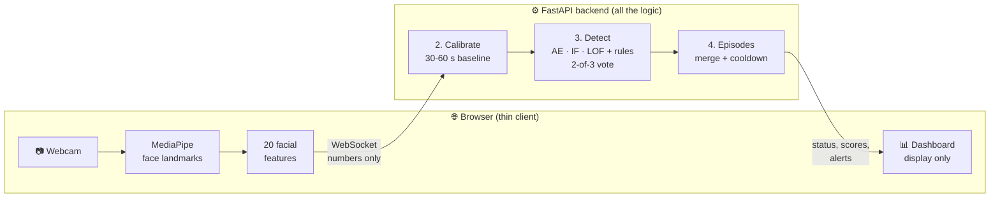

<div align="center">

# 🚗 DriverSafe

### Drowsiness Detection via Facial Anomaly Recognition

**An unsupervised AI system that learns what an alert face looks like and warns the driver when it stops looking that way. No drowsy labels, no video upload.**

[](https://driversafe-cuag.vercel.app)
[](#-limitations-and-roadmap)

[](https://react.dev)
[](https://www.typescriptlang.org)
[](https://vitejs.dev)
[](https://fastapi.tiangolo.com)
[](https://www.python.org)
[](https://numpy.org)
[](https://developers.google.com/mediapipe)
[](https://vercel.com)

</div>

---

> [!IMPORTANT]
> **Design philosophy: maximum backend complexity, minimum frontend complexity.** The browser captures, extracts 20 numbers and displays. Detection, calibration, episode logic and every decision live in the backend.

> [!WARNING]
> **DriverSafe is a research prototype and not a certified safety device.** All models are trained on **synthetic data**, and no real-driver validation has been done yet. Never rely on it to prevent a crash. See [Limitations and Roadmap](#-limitations-and-roadmap).

---

## 📑 Table of Contents

1. [The Problem](#-the-problem)
2. [The DriverSafe Idea](#-the-driversafe-idea)
3. [System Architecture](#-system-architecture)
4. [The 20 Facial Features](#-the-20-facial-features)
5. [The Three-Model Anomaly Ensemble](#-the-three-model-anomaly-ensemble)
6. [Decision Logic and Per-Driver Calibration](#-decision-logic-and-per-driver-calibration)
7. [Episodes and Cooldown](#-episodes-and-cooldown)
8. [Honest Evaluation](#-honest-evaluation)
9. [The Dashboard](#-the-dashboard)
10. [Privacy by Design](#-privacy-by-design)
11. [Project Structure](#-project-structure)
12. [Verification](#-verification)
13. [Quick Start](#-quick-start)
14. [Deploy on Vercel](#-deploy-on-vercel)
15. [API Reference](#-api-reference)
16. [Limitations and Roadmap](#-limitations-and-roadmap)
17. [Research Paper](#-research-paper)
18. [License](#-license)

---

## 🎯 The Problem

Drowsiness builds silently, and the first signs show on the face: the eyes stay closed longer, yawns repeat, the head droops. A tired driver is the worst judge of their own alertness.

The obstacle for AI is the data:

| Challenge | Why it matters |
|---|---|
| **Drowsy examples cannot be recorded safely** | Filming people falling asleep at the wheel is dangerous, and acted drowsiness differs from the real state |
| **Supervised detectors need those labels** | Without a "drowsy" class to learn from, a classifier has nothing to train on |
| **False alarms get systems switched off** | A detector that cries wolf is turned off by the driver |
| **Video upload is a privacy problem** | A camera pointed at a face should not stream to a server |

---

## 💡 The DriverSafe Idea

Instead of learning what drowsiness looks like, **DriverSafe learns what a normal, alert face looks like and flags everything that deviates from it.** This is anomaly detection, and it needs only data of normal behavior.

- 🧠 **Unsupervised.** An autoencoder, an isolation forest and a local outlier factor (LOF) model are trained on alert-driver data only.
- 🗳️ **Agreement, not a single opinion.** A frame is drowsy when at least **2 of the 3 models** agree, or when a rule fires for prolonged eye closure or yawning.
- 👤 **Per-driver calibration.** The first 30 to 60 seconds adapt the eye and mouth rule thresholds to the individual.
- 🔔 **One alert per episode.** Consecutive drowsy frames merge into a single episode with a cooldown.
- 🔒 **Private.** The browser sends **20 numbers per frame**. Video never leaves the device.
- ⚡ **Light.** Inference runs in plain **NumPy** (about 1.4 ms per frame), with no deep-learning runtime on the server.

---

## 🏗️ System Architecture



| Stage | Where | What happens |
|---|---|---|
| **1. Capture** | Browser | MediaPipe finds the face and the client computes 20 features. Video is never uploaded. |
| **2. Calibrate** | Backend | The first 30 to 60 s (and at least 100 accepted frames) set the driver's baseline. No alerts fire. |
| **3. Detect** | Backend | Three models score each frame. The 2-of-3 vote and the eye and yawn rules decide. |
| **4. Episodes** | Backend | Drowsy frames merge into one episode. A cooldown limits repeat alerts. |
| **5. Dashboard** | Browser | Live status, model scores, clustering views, alert history and CSV export. |

A frame with **no face or extreme values is rejected, not scored.**

---

## 🧬 The 20 Facial Features

| Group | Features |
|---|---|
| **Eyes (9)** | left and right eye aspect ratio, average eye aspect ratio, left and right eye openness, left and right pupil position (horizontal and vertical) |
| **Mouth (4)** | mouth aspect ratio, jaw openness, left and right mouth corner |
| **Brows (3)** | left and right eyebrow height, forehead crease |
| **Head (4)** | horizontal and vertical head tilt, nose tip height, chin position |

Every feature is normalized to `[0, 1]` and then standardized with the training mean and standard deviation before scoring.

---

## 🤖 The Three-Model Anomaly Ensemble

| Model | Configuration | Flags a frame when |
|---|---|---|
| **Autoencoder** | 20-16-12-8-12-16-20, ReLU, Adam (1e-3), 100 full-batch epochs, MSE | reconstruction error is above the **90th percentile** of training errors (1.298) |
| **Isolation Forest** | 200 trees, contamination 0.10 | the sample is judged an outlier |
| **LOF** | k = 20, contamination 0.10, novelty mode | the sample is judged an outlier |

All three are trained **only on alert-driver data**. The dashboard also shows **K-Means (k = 3)**, **DBSCAN (eps 0.8, min 10 points)** and a **10-component PCA** on recent frames. On the training data K-Means reaches a silhouette score of 0.588 and a Davies-Bouldin index of 0.943.

Models are trained offline with PyTorch and scikit-learn, then **exported as arrays so the deployed backend runs inference in plain NumPy.**

---

## 🎚️ Decision Logic and Per-Driver Calibration

A frame is **drowsy** when any of these holds:

$$D_t = M_t \lor E_t \lor Y_t$$

| Signal | Definition |
|---|---|
| **M**: model vote | at least 2 of the 3 models flag the frame |
| **E**: eye closure | both eyes closed continuously for **1.5 s**, or closed in **80 %** of a **10 s** window (at least 16 frames) |
| **Y**: yawn | mouth open for **1.5 s**, or **two yawns within 60 s** |

**Per-driver calibration** adapts the rule thresholds from the driver's own baseline (mean $\mu$ and standard deviation $\sigma$ over accepted frames), with clipping so a noisy calibration cannot disable the rules:

$$\theta_{eye} = \mathrm{clip}\big(\mu_{eye} - \max(2\sigma_{eye},\,0.18),\; 0.35,\; 0.55\big)$$

$$\theta_{mouth} = \mathrm{clip}\big(\mu_{mouth} + \max(2\sigma_{mouth},\,0.20),\; 0.55,\; 0.80\big)$$

Defaults before calibration are **0.48** for each eye and **0.55** for the mouth. The three models are **not** retrained, so calibration is instant and the logic stays in the backend.

---

## 🔔 Episodes and Cooldown

Frame-level decisions are noisy, so DriverSafe turns them into **episodes**:

- Consecutive drowsy frames merge into one episode with a **start time, end time and peak severity**.
- An episode that starts within the **cooldown (default 30 s)** of a previous alert is still saved in the history, but it does **not** raise a new alert event.
- The result: a complete history, and one warning per drowsy event.

---

## 📊 Honest Evaluation

> [!NOTE]
> Every number below comes from **synthetic data**. They describe how well the detectors separate artificial classes. They do **not** describe real drivers.

**Synthetic data:** 3,000 alert, 600 transition (partly closed eyes) and 400 drowsy samples. Models are trained on the alert class only. The drowsy class is the positive class.

### Offline scores stored with the trained models

| Detector | Precision | Recall | F1 | ROC-AUC |
|---|---|---|---|---|
| Autoencoder | 0.308 | 1.000 | 0.471 | 1.000 |
| Isolation Forest | 0.308 | 1.000 | 0.471 | 0.995 |
| LOF | 0.318 | 1.000 | 0.483 | 1.000 |
| **2-of-3 vote** | **0.312** | **1.000** | **0.475** | 0.893 ¹ |

¹ Computed from the vote count, which has only four values.

### Held-out check on fresh data (5 new seeds, mean ± std)

The original test set contains the training alert samples, so the models were also scored on five freshly generated data sets with the **production inference code** ([`backend/evaluation/heldout_eval.py`](backend/evaluation/heldout_eval.py), about 30 seconds to run).

| Detector | Precision | F1 | Alert frames flagged |
|---|---|---|---|
| Autoencoder | 0.303 ± 0.005 | 0.465 | 10.7 % |
| Isolation Forest | 0.306 ± 0.003 | 0.468 | 10.3 % |
| LOF | 0.311 ± 0.005 | 0.475 | 9.5 % |
| **2-of-3 vote** | **0.308 ± 0.005** | **0.470** | **10.0 %** |

### Why precision is about 0.31

Recall is 1.0, so precision is set by the false positives:

$$P = \frac{N_d}{N_d + \rho_t N_t + \rho_a N_a} = \frac{400}{400 + 1.0 \cdot 600 + 0.10 \cdot 3000} \approx 0.31$$

1. The **transition class** (partly closed eyes) is genuinely anomalous, so every detector flags it, yet it counts as negative.
2. Each threshold sits at the **90th percentile** of training scores, so about **10 % of alert frames are flagged by design**.
3. The three models' false positives largely coincide, so the vote does not lower the rate.

ROC-AUC near 1.0 means the **ranking is perfect on this easy synthetic data**, so a stricter threshold would raise precision. Do not expect such a clean ranking on real faces.

### Inference speed

| | Per frame (3-model pipeline, 1 CPU thread) |
|---|---|
| Before the fix (arrays re-decompressed on every access) | about **2.7 s** |
| After loading the arrays into memory once | **1.4 ms** mean, 1.9 ms p95 |

Outputs were identical on every frame compared.

---

## 🖥️ The Dashboard

| Tab | What it shows |
|---|---|
| **Live Monitor** | Webcam feed, frames sent and acknowledged, alert events, live autoencoder reconstruction error, and the eye, yawn and model-consensus signals |
| **Clustering** | Live K-Means and DBSCAN views of the most recent frames, cluster summary and elbow plot |
| **Metrics** | Offline detection metrics, confusion matrix, ROC curve and live timeline |
| **Alert History** | Alert episodes with start, end and severity, plus **CSV export** |
| **System settings** | A **Reset Live Session** button that clears calibration, counters and episodes |

If no camera is available, the backend supplies a **clearly labeled synthetic demo stream** so the pipeline can still be shown.

---

## 🔒 Privacy by Design

- 📷 **Video never leaves the device.** Only 20 feature numbers per frame are sent.
- 🗃️ **No accounts, no database, no personal data stored** in the demo version.
- 🧠 The history lives **in memory** and resets when the server restarts.
- ⚠️ All visitors to the public demo **share one live session**.

---

## 📁 Project Structure

```
DriverSafe/
├── frontend/                  # React + TypeScript + Vite (thin client)
│   └── src/
│       ├── App.tsx            # Routes
│       ├── pages/dashboard.tsx
│       ├── hooks/useApi.ts    # Polling and WebSocket hooks
│       └── lib/
│           ├── api.ts         # HTTP + WebSocket client
│           └── face-landmarks.ts   # MediaPipe feature extraction
├── backend/                   # FastAPI (all the logic)
│   ├── app.py                 # Vercel entrypoint
│   ├── main.py                # App, CORS, routers
│   ├── routers/
│   │   ├── detection.py       # WebSocket + models + rules + calibration + episodes
│   │   ├── alerts.py          # History, stats, CSV export
│   │   ├── metrics.py         # Offline and live metrics
│   │   ├── clustering.py      # K-Means, DBSCAN, PCA, hierarchical
│   │   └── live_clustering.py # Clusters on recent live frames
│   ├── utils/
│   │   ├── live_session.py    # Per-session live state, calibration, episodes
│   │   ├── alert_store.py     # In-memory alert history
│   │   ├── numpy_ml.py        # NumPy inference helpers
│   │   └── demo.py            # The single shared demo identity
│   ├── data/
│   │   ├── generate_dataset.py    # Synthetic feature generator
│   │   └── train_models.py        # Offline training (PyTorch + scikit-learn)
│   ├── saved_models/          # Trained artifacts + NumPy runtime export
│   ├── evaluation/            # Metrics code and tests
│   └── tests/                 # Backend regression tests
├── lib/                       # Shared workspace packages (API schema and client)
├── vercel.json                # Two services on one origin
└── PROJECT_ARCHITECTURE.md
```

---

## ✅ Verification

| Check | Command | Result |
|---|---|---|
| Backend tests | `cd backend && python -m unittest discover` | **8 / 8 pass**, with no environment variables |
| Frontend typecheck | `pnpm --filter @workspace/driversafe run typecheck` | clean |
| Frontend build | `pnpm --filter @workspace/driversafe run build` | succeeds |
| End to end | real server, 45 s of feature frames over the WebSocket | calibration → active → drowsy detected → 1 alert saved, no processing errors |

The backend tests cover startup and health, public routes, CSV export, the HTTP demo frame endpoint, evaluation metrics, and a regression test that streams a drowsy episode over the WebSocket and checks that **every frame is returned**.

---

## 🚀 Quick Start

**Requirements:** Python 3.12 and Node.js with [pnpm](https://pnpm.io).

```bash
# 1. Backend
python -m venv .venv
# Windows:  .venv\Scripts\activate      macOS/Linux:  source .venv/bin/activate
pip install -r backend/requirements.txt
cd backend
uvicorn main:app --reload --port 8000
```

```bash
# 2. Frontend (second terminal, from the repository root)
pnpm install
pnpm --filter @workspace/driversafe run dev
```

Open **http://localhost:5173**, allow the camera, look at it naturally for the 30 second calibration, then try closing your eyes for a few seconds.

**No environment variables are required.** Optional settings:

| Variable | Default | Purpose |
|---|---|---|
| `CALIBRATION_SECONDS` | `30` | Calibration length (30 to 60) |
| `ALERT_COOLDOWN_SECONDS` | `30` | Cooldown between alert events |
| `FRONTEND_ORIGINS` | open | Comma-separated origins to restrict CORS |
| `VITE_API_URL`, `VITE_WS_URL` | same origin | Only if the API runs on another origin |

**Run the tests** with `pip install -r backend/requirements-dev.txt` and then `python -m unittest discover` from `backend/`.

**Reproduce the held-out evaluation** with `pip install pandas scikit-learn` and then `python evaluation/heldout_eval.py` from `backend/`.

---

## ☁️ Deploy on Vercel

The root [`vercel.json`](vercel.json) defines **two services on one origin**: the FastAPI backend and the Vite frontend, with `/api/*` routed to the backend.

1. Import the repository in Vercel with **Root Directory** `.`.
2. Deploy. **No environment variables are needed.**
3. Open `/api/health`. It should return `{"status": "ok", "mode": "demo"}`.

> [!NOTE]
> Live state is kept in memory, and Vercel Functions limit connection duration and may route a reconnect to another instance. For long camera sessions, a persistent host or a local run is more reliable.

---

## 🔌 API Reference

| Method | Endpoint | Description |
|---|---|---|
| `WS` | `/api/detection/ws` | Send 20 features per frame, receive status, scores and episode events |
| `POST` | `/api/detection/demo/frame` | Synthetic demo frame over HTTP |
| `GET` | `/api/detection/status` | Detection service status |
| `GET` | `/api/alerts/history` | Alert episodes |
| `GET` | `/api/alerts/stats` | Frame counts, alert counts, session duration |
| `GET` | `/api/alerts/export` | Alert history as CSV |
| `GET` | `/api/metrics/live` · `/live/roc` · `/live/timeline` | Live metrics |
| `GET` | `/api/metrics/detection` · `/confusion` · `/roc` · `/clustering` · `/all` | Offline metrics |
| `POST` | `/api/metrics/reset` | Reset the live session |
| `GET` | `/api/cluster/kmeans` · `/dbscan` · `/pca` · `/hierarchical` · `/validation` | Offline clustering |
| `GET` | `/api/cluster/live` · `/live/validation` | Clustering on recent live frames |
| `GET` | `/api/health` · `/health` | Health check |

---

## 🧭 Limitations and Roadmap

**Honest limitations**

- ❌ Models are trained on **synthetic data**. The scores do not predict performance on real drivers.
- ❌ **No real-driver validation yet**, and the live demonstration is one subject with no labels.
- ❌ The **frame-level false-flag rate on alert frames is about 10 %** by threshold choice. False alarms per hour with the full pipeline have **not been measured yet**.
- ❌ Calibration adapts the rule thresholds but not the models.
- ❌ The public demo has **one shared session** and **in-memory history**.

**Roadmap**

- [ ] Record consented real sessions (normal driving, long blinks, yawns, head nods) and report **false alarms per hour** and detection delay
- [ ] Compare against a simple eye-aspect-ratio baseline and run ablations (without calibration, rules or cooldown)
- [ ] Choose thresholds on a validation set instead of a fixed percentile
- [ ] Model the dynamics of blinks and yawns over time
- [ ] Test lighting, glasses and camera angles, then a driving simulator
- [ ] Per-user accounts and persistent history (a version with accounts, PostgreSQL and recordings exists on the `full-auth` branch)

---

## 📄 Research Paper

An IEEE-format paper describes the method, the synthetic-data evaluation and the live demonstration: *"DriverSafe: Drowsiness Detection via Facial Anomaly Recognition."*

**References behind the methods:** Isolation Forest (Liu, Ting and Zhou, ICDM 2008), LOF (Breunig et al., SIGMOD 2000), autoencoders (Hinton and Salakhutdinov, Science 2006), DBSCAN (Ester et al., KDD 1996), the eye aspect ratio (Soukupová and Čech, CVWW 2016) and MediaPipe (Lugaresi et al., 2019).

---

## 📝 License

No license file has been added yet. Add a `LICENSE` file (for example MIT) before others reuse the code.

---

<div align="center">

**Built by [Rishu Raj](https://github.com/rishu-o2)** · Lovely Professional University

*A prototype that learns normal. Anomalies raise the alert.*

</div>
